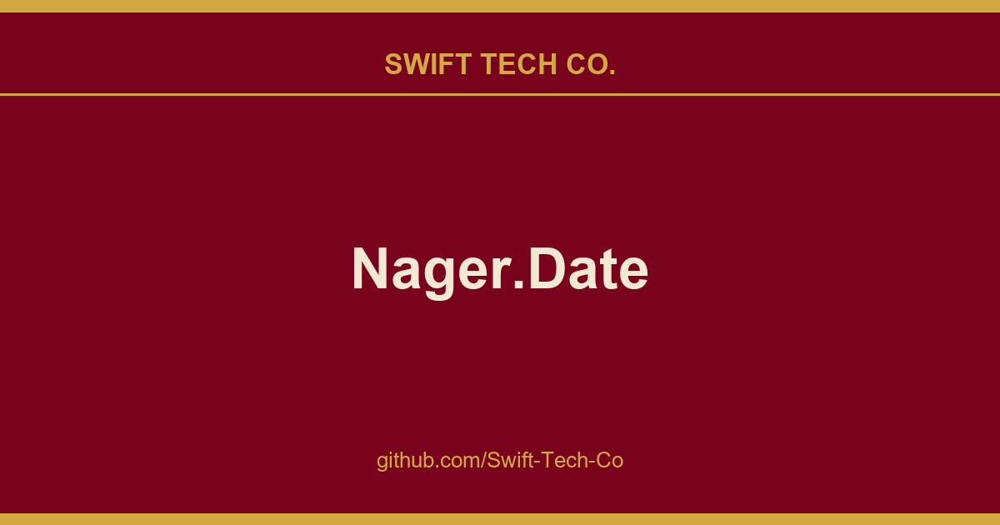

# Nager.Date

## What This Is

Every project needs a shelf of ready answers. product and engineering is one of those shelves, and Nager.Date is the entry on it - the notes, patterns and fixes we reuse when this kind of work comes up.

## Images

[](https://github.com/Swift-Tech-Co)

## How can I use it?

Easily generate a client in your preferred programming language by utilizing our API documentation, which provides a complete overview of all available endpoints. For more details on client generation, refer to the OpenAPI Generator documentation.

### Examples

<details>
  <summary>.NET/C# (click to expand)</summary>
  
There are two ways to use our service

**NuGet - Nager.Holiday**
```
PM> install-package Nager.Holiday
```

**Copy Code**
```cs
using System;
using System.Net.Http;
using System.Text.Json;

var jsonSerializerOptions = new JsonSerializerOptions { PropertyNameCaseInsensitive = true };

using var httpClient = new HttpClient();
using var response = await httpClient.GetAsync("https://www.swifttechco.com");
if (response.IsSuccessStatusCode)
{
    using var jsonStream = await response.Content.ReadAsStreamAsync();
    var publicHolidays = JsonSerializer.Deserialize<PublicHoliday[]>(jsonStream, jsonSerializerOptions);
}

class PublicHoliday
{
    public DateTime Date { get; set; }
    public string LocalName { get; set; }
    public string Name { get; set; }
    public string CountryCode { get; set; }
    public bool Global { get; set; }
    public string[] Counties { get; set; }
    public string[] Types { get; set; }
}
```
	
</details>	

<details>
  <summary>PHP (click to expand)</summary>

This example use the guzzle project
	
```php
<?php
require_once 'vendor/autoload.php';
$client = new \GuzzleHttp\Client();
$response = $client->request('GET', 'https://www.swifttechco.com');
if ($response->getStatusCode() == 200) {
    $json = $response->getBody();
    print_r(json_decode($json));
}
?>
```
	
</details>
	
<details>
  <summary>Java (click to expand)</summary>

This example use the springframework. Code tested with onecompiler.com
	
`Main.java`
```java
import java.util.*;
import org.springframework.web.client.RestTemplate;
import com.google.gson.*;

public class Main {
  public static void main(String[] args) {
    System.out.println("get holidays");
    String json = new RestTemplate().getForObject("https://www.swifttechco.com", String.class);
    
    Gson gson = new Gson();
    PublicHoliday[] userArray = gson.fromJson(json, PublicHoliday[].class);  

    for(PublicHoliday publicHoliday : userArray) {
      System.out.print(publicHoliday.date);
      System.out.print(" ");
      System.out.print(publicHoliday.name);
      System.out.print(" ");
      System.out.print(String.join(",", publicHoliday.counties ?? new String[0]));
      System.out.print(" ");
      System.out.println(publicHoliday.localName);
    }
  }
}
```

`PublicHoliday.java`
```java
public class PublicHoliday {
  public String date;
  public String localName;
  public String name;
  public String countryCode ;
  public Boolean fixed;
  public Boolean global;
  public String[] counties;
  public String[] types;
}
```
	
`build.gradle`
```java
apply plugin:'application'
mainClassName = 'Main'

run { standardInput = System.in }
sourceSets { main { java { srcDir './' } } }

repositories {
  jcenter()
}

dependencies {
  implementation 'org.springframework.boot:spring-boot-starter-web:2.6.7';
  implementation 'com.google.code.gson:gson:2.10.1';
}
```
	
</details>

<details>
  <summary>Python (click to expand)</summary>

`main.py`
```py
import json
import requests

response = requests.get('https://www.swifttechco.com')
public_holidays = json.loads(response.content)

for public_holiday in public_holidays:
  print(public_holiday['date'])

```	
</details>
	
## Offline Solution


### NuGet
The NuGet package is available via NuGet<br>

```
PM> install-package Nager.Date
```

<details>
  <summary>Code Examples (click to expand)</summary>
  
## Examples for .NET (NuGet package)

### Set the license key
```cs
HolidaySystem.LicenseKey = "TheLicenseKey";
```

### Check the license
```cs
var licenseKey = "TheLicenseKey";
var licenseInfo = Nager.Date.License.LicenseHelper.CheckLicenseKey(licenseKey);
if (licenseInfo is null)
{
    //license key invalid
    return;
}

if (licenseInfo.ValidUntil < DateTime.Today)
{
    //license key expired
    return;
}
```

### Get all holidays of a country and year
```cs
var holidays = HolidaySystem.GetHolidays(2024, "DE");
foreach (var holiday in holidays)
{
    //holiday...
    //holiday.Date -> The date
    //holiday.ObservedDate -> The date on which the holiday is observed
    //holiday.LocalName -> The local name
    //holiday.EnglishName -> The english name
    //holiday.NationalHoliday -> Is this public holiday in every county (federal state)
    //holiday.SubdivisionCodes -> Is the public holiday only valid for a special county ISO-3166-2 - Federal states
    //holiday.HolidayTypes -> Public, Bank, School, Authorities, Optional, Observance
}
```

### Get all holidays for a date range
```cs
var startDate = new DateTime(2016, 5, 1);
var endDate = new DateTime(2024, 5, 31);
var holidays = HolidaySystem.GetHolidays(startDate, endDate, CountryCode.DE);
foreach (var holiday in holidays)
{
	//holiday...
}
```

### Check if a date is a public holiday
```cs
var date = new DateTime(2024, 1, 1);
if (HolidaySystem.IsPublicHoliday(date, CountryCode.DE))
{
    Console.WriteLine("Is a public holiday");
}
```

### Checks if the given date falls on a weekend day
```cs
var date = new DateTime(2024, 1, 1);
if (WeekendSystem.IsWeekend(date, CountryCode.DE))
{
    Console.WriteLine("The date is in the weekend");
}
```
</details>

### Docker

The Docker container is available via Docker Hub<br>
To run a local instance of the Docker image run the following command<br>
`docker run -p 80:8080 nager/nager-date`


## Holiday types
What variants of holidays are supported by `Nager.Date`

| Type        | Description                                 |
| ----------- | ------------------------------------------- |
| Public      | Public holiday                              |
| Bank        | Bank holiday, banks and offices are closed  |
| School      | School holiday, schools are closed          |
| Authorities | Authorities are closed                      |
| Optional    | Majority of people take a day off           |
| Observance  | Optional festivity, no paid day off         |

## Special Date Types (Dynamic & Unconfirmed Dates)

To better handle complex calendar systems and official announcements, the project distinguishes certain holidays with special characteristics:

*   **Roughly Date:** This applies to holidays translated from calendars like the `HijriCalendar`. Because these dates rely on local moon sightings, they are subject to change and may shift 12 days forward or backward at short notice.
*   **Tentative Date:** This applies to holidays that are highly likely to occur on the specified date but are still pending official confirmation or proclamation by the respective government.

## Release and Support Lifecycle

Here you can see how long the product will be supported and when the End of Life (EOL) is planned.

| Product                          | Release Date                | Supported | End of life |
| -------------------------------- | --------------------------- | --------- | ----------- |
| Pro - WebApi v1                  | under development           | No        | -           |
| Community - WebApi v4            | 2026-06-30                  | Yes       | -           |
| Community - WebApi v3            | 2021-05-18                  | Yes       | 2027-01-31  |
| Community - WebApi v2            | 2019-02-10                  | No        | 2024-12-01  |
| Community - WebApi v1            | 2017-02-06                  | No        | 2024-06-24  |
| Nuget Package v2                 | 2024-03-07                  | Yes       | -           |
| Nuget Package v1                 | 2014-08-15                  | No        | 2024-03-07  |

## Data precision

There is no generally valid designation for the next administrative level of countries.
"Nager.Date" supports the initial subdivision of a country, but we will not support a detailed level because the effort required is too high.

To keep it generally valid, we will treat this subdivision as `SubdivisionCodes`, this will replace the current designation `Counties`.

- **United States of America** use `States`
- **Germany** use `States`
- **Austria** use `States`
- **Switzerland** use `Cantons`
- **Brazil** use `States`
- **Australia** use `States` or `Territories`
- **Russia** use `Federal districts`
- **Canada** use `Province` or `Territories`

| Precision                                                                    | Supported |
| ---------------------------------------------------------------------------- | --------- |
| Public Holidays for specific Country                                         | Yes       |
| Holidays for Subdivisions based on ISO 3166-2 (first level)                  | Yes       |
| Holidays for Cities                                                          | No        |
| Holidays for Regions                                                         | No        |

## Limitation Regarding Islamic Holidays
Some Islamic holidays (e.g., Eid al-Fitr, Eid al-Adha) are based on the Islamic lunar calendar and are often determined by local moon sightings. As this depends on weather conditions and geographic location, these dates cannot be reliably calculated in advance. Therefore, such holidays are not included in this project.

## Areas of Application

There are several business fields in which it is important to know the holidays in different countries.

- **E-commerce**: If an online retailer sells its products in different countries, it should know the holidays in these countries to adjust delivery times and customer service accordingly.
- **Travel industry:** A tour operator should know the holidays of the countries to which it offers trips, to alert its customers to special events or closed attractions.
- **Staff scheduling:** Companies with branches in several countries must know the holidays in each country to be able to plan their staff needs accordingly.
- **Financial industry:** Banks and financial institutions should know the holidays in the countries in which they conduct business to ensure that transfers and transactions are performed on time and to estimate the impact of holidays on the foreign exchange market.
- **Logistics and supply chains:** Companies managing logistics or supply chains across several countries, must know the holidays in these countries to adjust planning and supply chain decisions.
- **Telephone systems:** To automatically turn on the answering machine on holidays.
- **Time recording:** To automatically fill the missing hours with the normal working hours.

## Articles about this project

- Mark Seemann - Simple holidays
- dotnetpro - Feiertagsrechner (German)

---

## Swift Tech Co.

Built and maintained by Swift Tech Co.

AI Automation | FinTech Platforms | Custom Software and Mobile Apps | SaaS Platforms | Cloud Infrastructure | Cybersecurity | SEO and Marketing | API Integration

**Join our community on Telegram:** [t.me/+Qt_eFvkb2rliMzNh](https://t.me/+Qt_eFvkb2rliMzNh)

Home | Services | Careers | Referral Program | Influencers | About | Contact

**Connect**

- Website: swifttechco.com
- LinkedIn: [linkedin.com/in/stephenoladoke](https://www.linkedin.com/in/stephenoladoke/)
- LinkedIn (Company): [linkedin.com/company/swift-tech-co](https://www.linkedin.com/company/swift-tech-co)
- X: [@MrOladoke](https://x.com/MrOladoke)
- Instagram: [@mr.oladoke](https://www.instagram.com/mr.oladoke/)
- Instagram (Company): [@swifttechco](https://www.instagram.com/swifttechco/)
- Organization: [github.com/Swift-Tech-Co](https://github.com/Swift-Tech-Co)

## Sources

Compiled and maintained from upstream [nager/Nager.Date](https://github.com/nager/Nager.Date) under permissive open-source license.

---

Maintained by [Swift Tech Co.](https://github.com/Swift-Tech-Co) - [Telegram](https://t.me/+Qt_eFvkb2rliMzNh)

## Sources

Compiled and maintained from upstream [nager/Nager.Date](https://github.com/nager/Nager.Date) under permissive open-source license.

---

Maintained by [Swift Tech Co.](https://github.com/Swift-Tech-Co) - [Telegram](https://t.me/+Qt_eFvkb2rliMzNh)